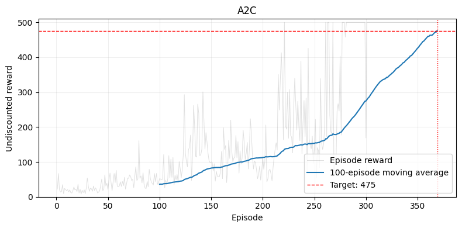
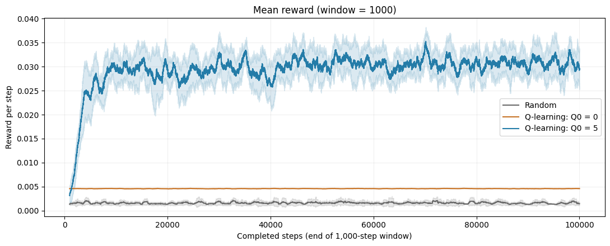
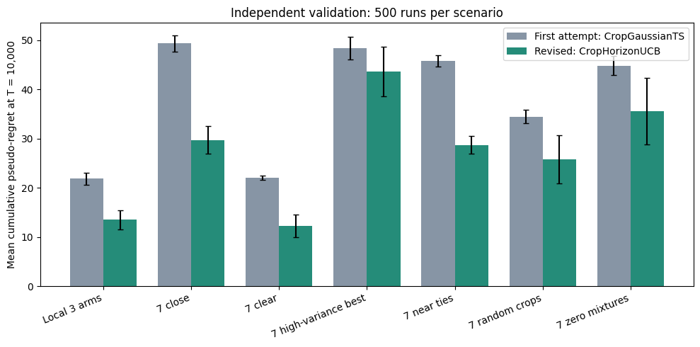

# Reinforcement Learning and Bandits

Policy-gradient, actor-critic, tabular and bandit methods implemented and tested in three course assignments. A2C solved CartPole-v1 in 369 episodes. A bandit policy designed for the task cut mean regret from 21.8 to 13.5 against the first attempt, over 500 validation runs.

**English** · [中文](README.zh-CN.md)

> This repository presents results from graded group assignments (groups of 2–3) in Advanced Topics in Machine Learning at Chalmers University of Technology. The code is not public because the assignments are graded course work.

  
   <em>A2C on CartPole-v1: the 100-episode average passes the 475 target after 369 episodes.</em>

## Results

- **REINFORCE in NumPy, without autograd.** The hand-derived policy gradient matched a numerical check with mean absolute error 2.7e-8. On GridWorld the mean reward over the last 50 updates was 0.998 (maximum 1).
- **A2C in PyTorch on CartPole-v1.** The 100-episode average reached 476.59 after 369 episodes, above the 475 target. With entropy regularisation it took 407 episodes (477.03).
- **Exploration in tabular Q-learning (RiverSwim).** Optimistic initialisation (Q₀ = 5) earned 0.0308 reward per step over the last 10,000 steps, against 0.0046 for Q₀ = 0, about 6.7 times more. The Q-value error fell to 0.026, against 12.2.
- **A bandit policy for choosing crop planting dates.** A variance-adaptive UCB with a finite-horizon bonus cut mean regret from 21.8 to 13.5 on the local 3-arm scenario. Across six synthetic 7-arm scenarios it lowered regret by about 10–45%.

## What was done

**Deep RL.** REINFORCE was written with NumPy only, so the policy gradient was derived by hand and checked numerically. A2C uses separate actor and critic networks (two hidden layers of 64 Tanh units each), 32-step rollouts, γ = 0.99 and Adam (actor 7e-4, critic 3e-3).

**Tabular RL.** RiverSwim is a continuing task where a small reward sits next to the start and a large one is far to the right. With Q₀ = 0 the agent soon settles for the small reward and stops exploring. Optimistic values make unvisited actions look attractive, so the agent keeps moving right until it finds the large reward.

  
   <em>RiverSwim: with Q₀ = 5 (blue) the agent finds the large reward; with Q₀ = 0 (orange) it stays near the small one.</em>

**Bandits.** Explore-First, ε-greedy, UCB1 and Thompson sampling were implemented and compared. Two regret-bound proofs were also part of the work. In the open task, seven planting dates are the arms and the yield is the reward. The first policy was a Gaussian Thompson sampler. The revised policy, `CropHorizonUCB`, scales its bonus by each arm's observed variance and by the remaining horizon. Its settings were fixed before the 500 validation runs, which used seeds kept apart from development. Both policies saw the same reward sequences for each seed, so the comparison is paired.

  
   <em>Validation, 500 runs per scenario: the revised policy (green) has lower regret in every scenario. In the high-variance scenario the gap is within two paired standard errors.</em>

## Tech stack

- **Language:** Python
- **Libraries:** NumPy, PyTorch, Gymnasium (CartPole-v1), Matplotlib, pandas
- **Methods:** REINFORCE, A2C, entropy regularisation, value iteration, Q-learning, Explore-First, ε-greedy, UCB1, Thompson sampling

## Limitations

- Small benchmark tasks: GridWorld, CartPole-v1 and RiverSwim.
- The bandit gain in the high-variance scenario is not conclusive.

## Links

- Portfolio: https://tjiewgnil.github.io/#rl
