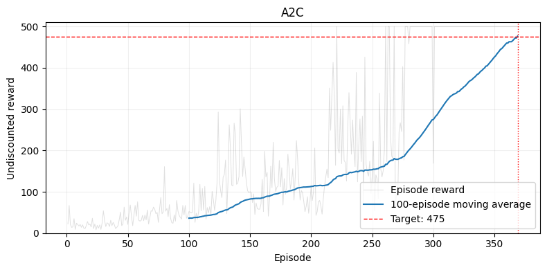
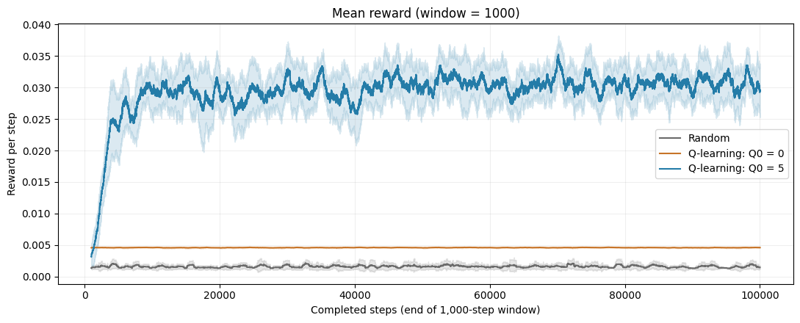
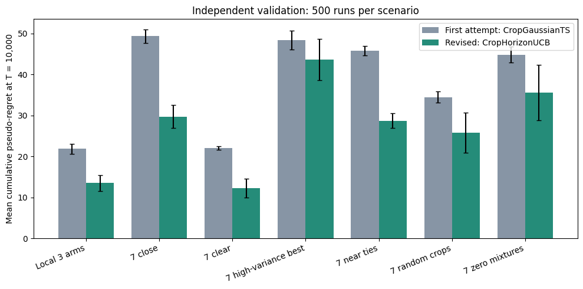

# 强化学习与多臂老虎机

在三次课程作业中实现并测试了策略梯度、actor-critic、表格方法和老虎机方法。A2C 用 369 个 episode 解决了 CartPole-v1。针对任务设计的老虎机策略在 500 次验证中，把平均遗憾从第一版的 21.8 降到 13.5。

[English](README.md) · **中文**

> 本仓库展示查尔姆斯理工大学"机器学习前沿专题"（Advanced Topics in Machine Learning）课程计分小组作业（2–3 人一组）的结果。作业属于计分课程作业，因此代码不公开。

  
   <em>CartPole-v1 上的 A2C：100 局平均奖励在第 369 局后超过 475 的目标。</em>

## 成果

- **只用 NumPy 实现 REINFORCE，不用自动求导。** 手推的策略梯度与数值检验相比，平均绝对误差为 2.7e-8。在 GridWorld 上，最后 50 次更新的平均奖励为 0.998（最大为 1）。
- **用 PyTorch 在 CartPole-v1 上实现 A2C。** 369 个 episode 后 100 局平均奖励达到 476.59，超过 475 的目标。加入熵正则后用了 407 个 episode（477.03）。
- **表格 Q-learning 的探索（RiverSwim）。** 乐观初始化（Q₀ = 5）在最后 10,000 步里每步奖励为 0.0308，Q₀ = 0 为 0.0046，约 6.7 倍。Q 值误差降到 0.026，Q₀ = 0 为 12.2。
- **为选择作物播种日期设计的老虎机策略。** 带有限时域项的方差自适应 UCB，在本地 3 臂场景上把平均遗憾从 21.8 降到 13.5。在 6 个合成的 7 臂场景上，遗憾降低约 10–45%。

## 做了什么

**深度强化学习。** REINFORCE 只用 NumPy 实现，所以策略梯度是手推的，并做了数值检验。A2C 的 actor 和 critic 是两个独立网络（各有两层 64 个 Tanh 单元），32 步 rollout，γ = 0.99，使用 Adam（actor 7e-4，critic 3e-3）。

**表格强化学习。** RiverSwim 是一个连续任务：起点旁边有一个小奖励，很远的右边有一个大奖励。Q₀ = 0 时，智能体很快满足于小奖励，不再探索。乐观的初始值让没试过的动作看起来更好，于是智能体会一直向右，直到找到大奖励。

  
   <em>RiverSwim：Q₀ = 5（蓝）找到了大奖励；Q₀ = 0（橙）一直停在小奖励附近。</em>

**多臂老虎机。** 实现并比较了 Explore-First、ε-greedy、UCB1 和 Thompson 采样，还完成了两道遗憾界证明题。开放任务把 7 个播种日期当作臂，产量当作奖励。第一版策略是高斯 Thompson 采样。改进后的策略 `CropHorizonUCB` 按每个臂观测到的方差和剩余步数调整探索项。它的参数在 500 次验证之前就已固定，验证用的随机种子和开发时分开。同一个种子下两种策略看到相同的奖励序列，所以比较是配对的。

  
   <em>验证，每个场景 500 次：改进版（绿）在每个场景中遗憾都更低。高方差场景中的差距在两个配对标准误以内。</em>

## 技术栈

- **语言：** Python
- **库：** NumPy、PyTorch、Gymnasium（CartPole-v1）、Matplotlib、pandas
- **方法：** REINFORCE、A2C、熵正则、值迭代、Q-learning、Explore-First、ε-greedy、UCB1、Thompson 采样

## 局限

- 都是小型基准任务：GridWorld、CartPole-v1 和 RiverSwim。
- 高方差场景下老虎机策略的提升不能确定。

## 链接

- 作品集：https://tjiewgnil.github.io/zh/#rl
